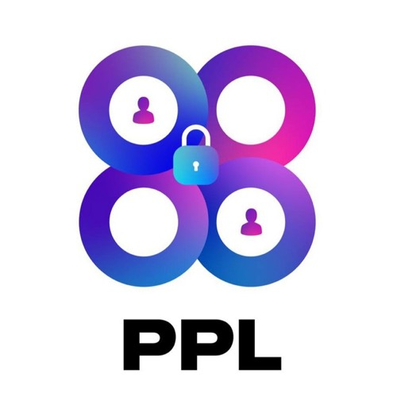
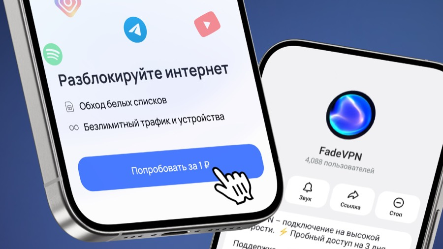
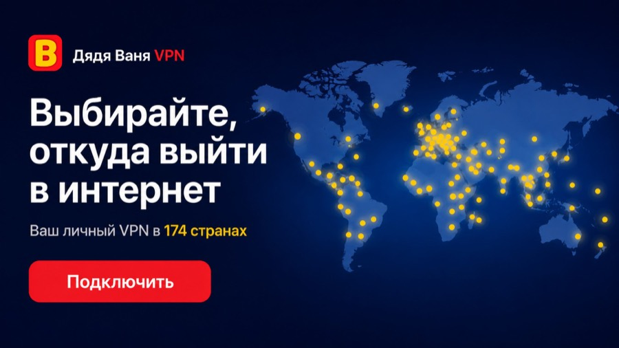
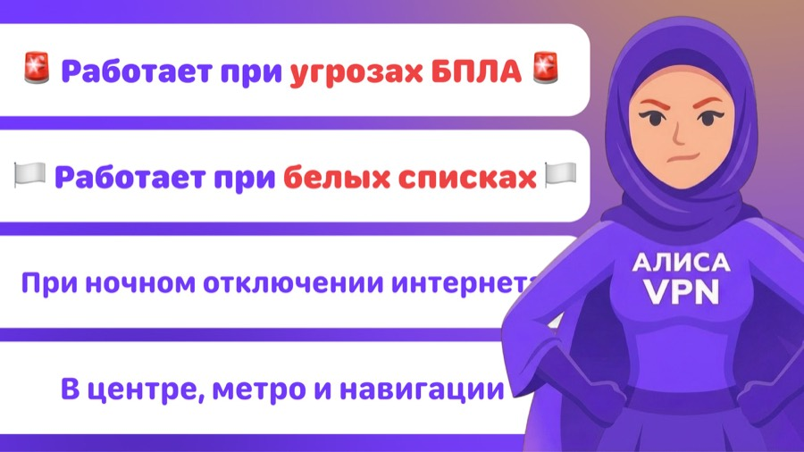
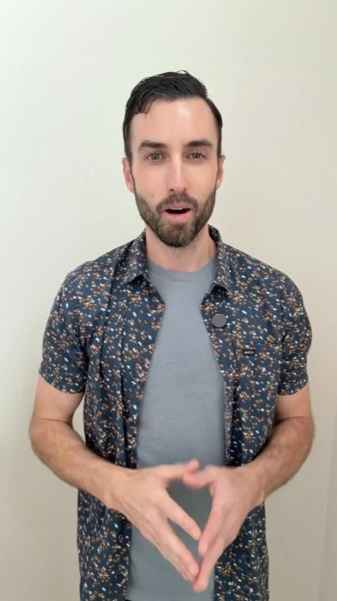
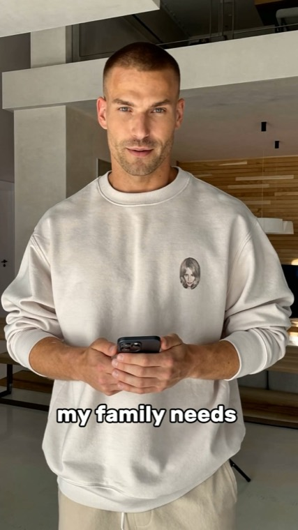
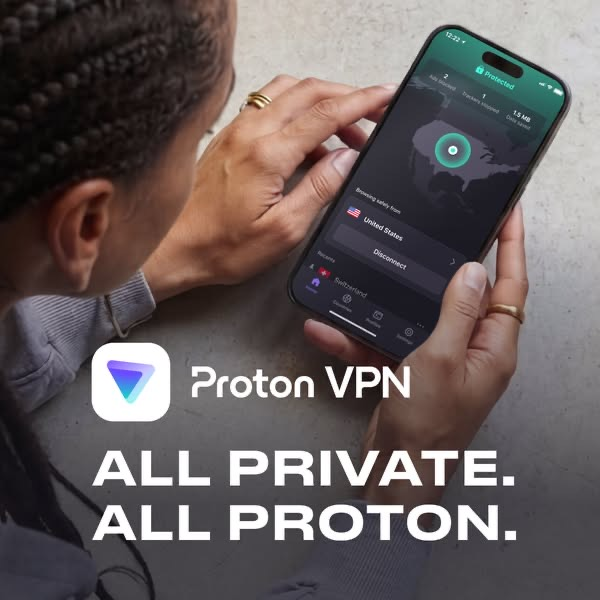
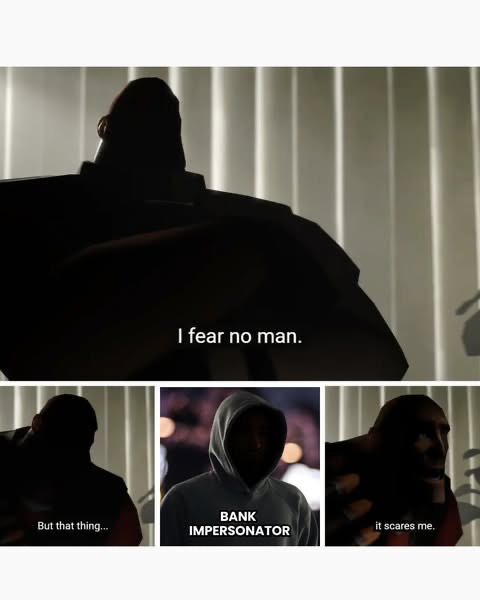
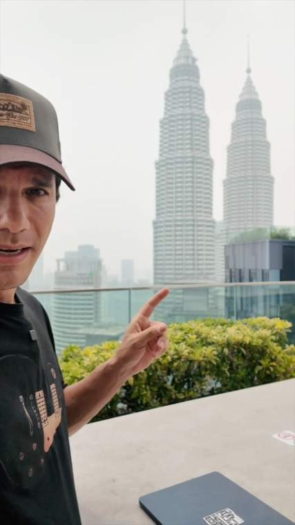
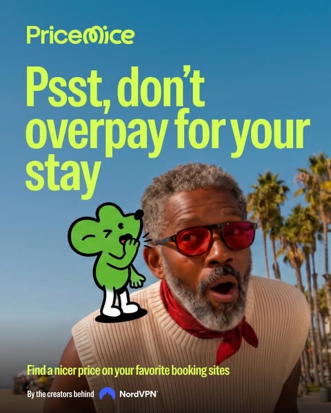

# Креативы VPN: Telegram Ads и Meta (28.10.2026)

Разведка по рекламе VPN: 10 объявлений из Telegram Ads по РФ и 10 зарубежных из Meta Ad Library. У каждого картинка, пересказ текста и путь клика.

Эта папка хранит два вида одного материала:
- `README.md` читается прямо на GitHub, картинки подтягиваются из `img/`.
- `index.html` та же страница, что опубликована как артефакт. Откройте файл в браузере, он работает локально вместе с `img/`.

Живая версия: https://claude.ai/artifact/NZCuAfcZdrtrVzGEPiztFm (закрытая, видна только владельцу).

| Площадка | Креативов |
|---|---|
| Telegram Ads, русскоязычные боты | 10 |
| Яндекс Директ и ВК | 0 (открытой базы нет) |
| Зарубежные, Meta (США) | 10 |

## Как выбирал «лучшие»

- Ни Telegram, ни Meta не отдают конверсии и затраты. Критерии косвенные: сколько объявление живёт, сколько у него вариантов, насколько крупный рекламодатель, разнообразие заходов.
- Порядок внутри списков идёт по силе этих признаков, не по результату. Срок в Telegram считается от начала наблюдений архива (апрель 2026), настоящий возраст может быть больше.
- Тексты даны пересказом. Дословные версии лежат в архиве по ссылке у каждой карточки.
- Доллары пересчитаны по курсу ЦБ 82,89 ₽ на 21.10.2026 (на 28.10 курс не нашёл).

## Контекст

- Реклама VPN в РФ запрещена с 1.09.2025, архив при этом показывает, что объявления идут.
- Свой тест Никиты в Telegram Ads: бюджет 70 000 ₽, 388 оплат по 180 ₽. Входные цены конкурентов в текстах: 20–99 ₽ в месяц плюс пробник, так что чек 180 ₽ выше. Это цены «от», сравнивать надо по составу подписки.
- Расчёт юнит-экономики лежит в `vpn-unit-economics.xlsx` (локально, не в этом репозитории).

---

## Telegram Ads: 10 объявлений по РФ

Источник: открытый архив Telegram-рекламы telegramadsarchive.com (в нём 29,5 тыс. VPN-объявлений, около 17,9 тыс. с гео РФ). Формат: до 160 знаков, кнопка «VIEW BOT», картинка по желанию.

**Что повторяется:**
- Пробник в тексте у восьми из десяти. От 2 до 7 дней у семи, у Alpha просто «бесплатно». Платный вход у двух: 1 ₽ (FadeVPN) и 10 ₽ (Дядя Ваня). Цена подписки в тексте у трёх (VUNO, PPL, Easy Go): от 20 до 99 ₽ в месяц.
- Язык блокировок у девяти из десяти: «не работает», «белые списки», «когда глушат». Только PPL продаёт одной ценой.
- Своя ссылка на каждое размещение: в параметре start коды площадок, UUID, pid.
- Конвейер вариантов: у рекламодателей по 22, 29, 60, 83, 86 и 135 объявлений. Меняют цену (33 и 83 ₽ в одной связке), число стран (5 и 7), эмодзи, срочность.
- Картинка у шести из десяти, остальные четыре работают текстом и кнопкой.
- Реклама своим клиентам: у Alice отдельные объявления про продление подписки, прокси для Telegram и роутеры с VPN.

**Что в воронке проверено:** объявление, ссылка на бота с меткой и описание бота с t.me. Экран после `/start`, тарифы и оплату внутри ботов не открывал.

### 1. Alice VPN: «VPN, который работает» и месяц за друга

`@alice_vpn_bot` · кабинет EUR · в эфире с 15.11.2024 · 5 объявлений в архиве

- **Картинка:** баннер 16:9, тёмно-синий неон. Ноутбук, три экрана с «ON», роутер, из ноутбука выглядывает аниме-героиня в очках.
- **Текст:** заход «просто работает». Новый протокол, устойчивый к блокировкам, и реферальный бонус: месяц подписки за каждого приглашённого друга.
- **Воронка:** объявление → бот, метка `start=TG` → «Проводник в интернет без ограничений» → подписка → месяц за друга.
- **Почему в списке:** единственный креатив с историей дольше двух лет. Соседние объявления работают на удержание (продление, прокси для Telegram, роутеры). Заход почти слово в слово повторил «Дядя Ваня VPN».
- [Все тексты в архиве](https://telegramadsarchive.com/advertisers/tg-alice-vpn-bot)

### 2. VPNPort: аптечка «Первая помощь интернету»

`@vpn_portbot` · кабинеты TON и EUR · с 30.03.2026 (212 дней) · 22 варианта

- **Картинка:** белый фон, чёрно-красный заголовок, аптечка с красным крестом и плашкой VPN.
- **Текст:** безлимит, 5 устройств, 7 стран, белые списки в один клик, поддержка 24/7. Варианты отличаются мелочами: пять восклицательных знаков, «5 стран» вместо «7».
- **Воронка:** объявление → бот с уникальным UUID в ссылке → «Быстрый и анонимный VPN, логи не храним» → пробник или покупка.
- **Почему в списке:** 212 дней при 22 вариантах. Тестируют формулировки, картинка прежняя.
- [Все тексты в архиве](https://telegramadsarchive.com/advertisers/tg-vpn-portbot)

### 3. VPN PPL: цена от 33 ₽ и 3 дня в подарок

`@vpnpplbot` · кабинеты TON и EUR · с 17.03.2026 (221 день) · 6 объявлений

- **Картинка:** квадратный логотип PPL, кольца с замком. Продаёт оффер в тексте, не картинка.
- **Текст:** «Быстрый и безопасный VPN», от 33 ₽ в месяц, 3 устройства, «нажмите сюда и получите 3 дня в подарок». Вариант со срочностью: игральные кубики, «только 7 дней», 99 ₽ в месяц на три устройства (19.08–29.09).
- **Воронка:** объявление → бот, в ссылке `pid=138113` → «Быстрый и безопасный сервис» и канал → 3 дня в подарок → тариф.
- **Почему в списке:** самый ранний в выборке после Alice. Единственный без языка блокировок. `pid` закодирован в base64, похоже на код партнёра или размещения.
- Что означает название PPL, неизвестно: расшифровки нет ни в рекламе, ни в архиве. В арбитраже PPL чаще всего значит Pay Per Lead (оплата за заявку), но связь с этим ботом не подтверждена.
- [Все тексты в архиве](https://telegramadsarchive.com/advertisers/tg-vpnpplbot)

### 4. Easy Go: «Работает» и 7 дней бесплатно, цена в тесте
Картинки нет, только текст и кнопка.

`@easygorobot` · кабинет EUR · с апреля 2026 (до 191 дня) · 29 объявлений

- **Текст:** VPN на протоколе, устойчивом к блокировкам, от 33 ₽ в месяц, семь дней бесплатно, «быстрая настройка в боте». В соседней копии той же даты стоит 83 ₽, идёт тест цены. Ещё ветка про «работают все сайты, российские и иностранные, без отключения VPN».
- **Воронка:** объявление → бот с меткой площадки (`ded_vpn_mir22`, `velvet_vpn_mir2`, `ab3_gigachat_bot_test`) → 7 дней бесплатно → оплата.
- **Почему в списке:** самый длинный пробник среди десяти, под каждое размещение своя ссылка.
- [Все тексты в архиве](https://telegramadsarchive.com/advertisers/tg-easygorobot)

### 5. VUNO: 20 ₽ за устройство и «подключайтесь сейчас»
Картинки нет.

`@vuno_vpn_bot` · кабинет TON · с апреля 2026 (до 190 дней) · 60 объявлений

- **Текст:** два тона. Цена: от 20 ₽ в месяц за устройство, до 5 устройств, безлимитный трафик, 5 дней в подарок. Нативный: «рекомендуем быстрое и безопасное соединение», «всё больше сайтов работают нестабильно, подключайтесь уже сейчас».
- **Воронка:** объявление → бот, метки `rbc`, `auto`, `stats` → «Безлимитный обход глушилок, YouTube без рекламы, 5 дней бесплатно» → оплата.
- **Почему в списке:** 60 объявлений на одном тексте и кнопке. Цена за устройство делает вход заметно дешевле, чем «от 99 ₽» за подписку.
- [Все тексты в архиве](https://telegramadsarchive.com/advertisers/tg-vuno-vpn-bot)

### 6. GROZA: «Новый VPN» и белый список для мобильного интернета
Картинки нет.

`@vpn_groza_bot` · кабинет TON · до 166 дней · 135 объявлений, больше всех в десятке

- **Текст:** каждый вариант подан как новость: «новый VPN уже доступен», «новые протоколы + белый список». Повторяются Wi-Fi и LTE, iPhone, Android и ПК, 2 дня бесплатно, «проверь и убедись сам». Много эмодзи и слово «НОВЫЙ» заглавными.
- **Воронка:** объявление → бот, метки `global_150` и `global_183` → «Установка занимает около 2 минут» → 2 дня бесплатно.
- **Почему в списке:** конвейер тестов, 135 вариантов с перестановками эмодзи, слов «новый» и порядка преимуществ.
- [Все тексты в архиве](https://telegramadsarchive.com/advertisers/tg-vpn-groza-bot)

### 7. FadeVPN: 3 дня за 1 ₽ и скриншот бота в самом креативе

`@fadevpnbot` · кабинет EUR · с апреля 2026 (до 188 дней) · 12 объявлений

- **Картинка:** синий фон, два телефона. На левом «Разблокируйте интернет», пункты «Обход белых списков» и «Безлимитный трафик и устройства», кнопка «Попробовать за 1 ₽», вокруг значки Instagram, Telegram, YouTube, Spotify. На правом профиль бота (4 088 пользователей).
- **Текст:** вопрос-боль «VPN не работает?» и ответ: три дня за 1 ₽. Позже добавили «обход белых списков», скорость до 10 Гбит/с, «15+», затем «30+ стран» и вариант «Happ VPN теперь доступен в Телеграме».
- **Воронка:** объявление → бот → кнопка «Попробовать за 1 ₽» → пробный доступ 3 дня → тариф.
- **Почему в списке:** платный пробник за 1 ₽ вместо бесплатного. Картинка показывает экран бота до клика. В одной ссылке остался незаполненный шаблон метки `[adHash]`.
- [Все тексты в архиве](https://telegramadsarchive.com/advertisers/tg-fadevpnbot)

### 8. Alpha VPN: «Снова не работает VPN?» и «Внимание, новый VPN!»
Картинки нет.

`@vpn_free` · кабинет TON · с апреля 2026 (до 188 дней) · 20 объявлений

- **Текст:** две ветки. Боль: «снова не работает VPN?», бесплатно, «всего за 2 клика». Интрига без цены и условий: «ВНИМАНИЕ, новый VPN!» и стрелки к кнопке. Третья: «улучшенный VPN теперь тут, бесплатный период для новичков».
- **Воронка:** объявление → бот, метки вида `A-xxxx` → «Есть бесплатный демо-период» → демо → оплата.
- **Почему в списке:** объявление без цены и без выгоды держится почти полгода. Формат «интрига плюс кнопка» проверен временем.
- [Все тексты в архиве](https://telegramadsarchive.com/advertisers/tg-vpn-free)

### 9. Дядя Ваня VPN: «Выбирайте, откуда выйти в интернет»

`@vanya_vpn_bot` · кабинеты TON и EUR · с апреля 2026 (до 186 дней) · 86 объявлений

- **Картинка:** баннер 16:9, тёмно-синяя карта мира с жёлтыми точками серверов, заголовок, строка «Ваш личный VPN в 174 странах», красная кнопка «Подключить».
- **Текст:** в апреле заход Alice, затем: надёжный VPN без блокировок, до 10 Гбит/с, безлимит устройств, 3 дня за 10 ₽. В сентябре: «бери за 10 рублей», «187 стран». Число стран плавает от 174 до 187.
- **Воронка:** объявление → бот (в апрельских ссылках другой бот проекта, `BEBRA_VPN_BOT`) → «Попробовать за 10 рублей» → 3 дня пробного → тариф.
- **Почему в списке:** 86 вариантов и платный вход за 10 ₽, как у FadeVPN за 1 ₽. Картинка передаёт идею выбора страны, а не страх.
- [Все тексты в архиве](https://telegramadsarchive.com/advertisers/tg-vanya-vpn-bot)

### 10. Алиса VPN: «Работает при угрозах БПЛА и при белых списках»

`@vpnalisabot` · кабинет TON · с апреля 2026 (до 185 дней) · 83 объявления

- **Картинка:** 16:9, фиолетовый. Четыре белые плашки с ситуациями: угрозы БПЛА, белые списки, ночное отключение интернета, центр города, метро и навигация. Справа персонаж в платке.
- **Текст:** разные заходы под разные аудитории. «Халяль!» для религиозного сегмента. «Российская разработка, работает, когда глушат, 3 дня без ввода карты, установка в 1 клик». Вариант с эмодзи пожилой женщины: пошаговая инструкция.
- **Воронка:** объявление → бот, метки `inv_…` → описание: сайт, канал, бот с инструкциями, поддержка → 3 дня без карты → тариф.
- **Почему в списке:** конкретные ситуации вместо абстрактного «быстрый VPN» и сегментация заходов по аудиториям: религия, возраст, место.
- [Все тексты в архиве](https://telegramadsarchive.com/advertisers/tg-vpnalisabot)

---

## Яндекс Директ и ВК: показать нечего

Десять креативов из этих площадок не набрал, выдумывать не стал.

- **Яндекс Директ:** в справке по запрещённым категориям VPN-сервисы названы прямо, вместе с обходом блокировок. Открытой базы объявлений у Директа нет, спай-сервиса с VPN по Директу не нашёл.
- **ВКонтакте:** библиотеки чужой рекламы у VK Рекламы нет. Раздел «Библиотека» в кабинете это фотосток и нейроизображения для своих объявлений. Единственный найденный документ по VPN в ВК относится к 2018 году.
- **Что остаётся:** только ручной способ, смотреть ленту и рекламные места с тестового аккаунта. Выборка получится случайной, без сроков и без счёта вариантов.

---

## Зарубежные: 10 креативов из Meta

Источник: Meta Ad Library, активные объявления в США (поиск по названиям брендов и слову vpn). Крупные бренды меняют креативы каждые несколько недель, поэтому по сроку почти не отсортировать. Отбирал по масштабу рекламодателя, числу копий и разнообразию заходов. Google Ads и TikTok не смотрел.

**Что повторяется:**
- Угроз блокировок нет. Заходы: приватность с юмором, мошенничество, защита покупок в Чёрную пятницу, поездки (стриминг, перелёты, отели).
- Видео у шести из десяти: вертикальные ролики от 10 до 60 секунд (говорящая голова, креатор, селебрити). Статика у четырёх.
- VPN продаётся пакетом: Nord говорит об антивирусе нового поколения, Surfshark о связке с антивирусом, ExpressVPN добавляет eSIM и менеджер паролей.
- Короткий путь клика: прямо на тарифы (Express), в корзину с купоном (PC Matic), на страницу креатора с кодом (Surfshark), через редирект-трекер (Proton).
- Гарантия возврата 30 дней у всех, чьи страницы удалось открыть.
- Сезонный оффер уже идёт: Чёрная пятница, «до 77% + 3 месяца» у Nord, «до 80%» у Express.

### 1. ExpressVPN: хакеры нас ненавидят, и нам нормально

Видео 51 с · показ начат 16–19.08.2026 · три копии в выдаче · видеофайл создан около полугода назад (по метаданным ссылки)

- **Картинка:** вертикальное видео. Человек в цветастой рубашке на светлой стене говорит в камеру, без графики и логотипа в первом кадре.
- **Текст:** шутка вместо угрозы: хакеры, рекламодатели и провайдер нас ненавидят, нас это устраивает. Одна строка пользы: данные, история просмотров и локация защищены. Призыв «верните контроль над цифровым следом».
- **Воронка:** объявление (UTM Facebook с макросами кампании) → `expressvpn.com/start/privacy/data-theft` → скидка до 80% (сезонная), гарантия 30 дней → бонус eSIM до 3 ГБ и менеджер паролей → все кнопки на тарифы.
- **Почему в списке:** крупный рекламодатель и UGC-стиль без постановки. Страница держит доверие: 412 тыс. оценок, награды, живой чат 24/7.
- [Meta Ad Library](https://www.facebook.com/ads/library/?id=1365522068503612)

### 2. ExpressVPN: сколько VPN-подписок нужно семье? Одна

Видео 19 с · показ начат 19.08.2026 · видеофайл создан около четырёх месяцев назад

- **Картинка:** вертикальное видео. Мужчина с телефоном в светлой гостиной, крупные субтитры.
- **Текст:** вопрос о числе подписок и ответ: один план закрывает телефоны, ноутбуки, телевизоры и планшеты. Цена подана как «чашка кофе в месяц».
- **Воронка:** объявление (`utm_source=meta`) → та же страница data-theft → тарифы.
- **Почему в списке:** тот же оффер и страница, другой заход (выгода вместо юмора). Express гоняет два захода на одну воронку.
- [Meta Ad Library](https://www.facebook.com/ads/library/?id=1071341612141918)

### 3. PC Matic: «Пенсионеры, вы сидите в сети без VPN?»

Видео 50 с, квадрат 1:1 · показ начат 19.02.2026 · идёт больше восьми месяцев

- **Картинка:** пожилой мужчина в очках в деревянном интерьере, поверх кадра заголовок о пенсионерах без VPN.
- **Текст:** данные остаются приватными где бы вы ни были. «Получите сегодня всего за $30» (≈2 490 ₽). В карточке: скидка 63%, «сделано в США».
- **Воронка:** объявление → `pcmatic.com/special/vpn30fyr` → 1 год $30 (≈2 490 ₽), обычно $50 (≈4 150 ₽), купон `VPN30FYR` → или 2 года $72 (≈5 970 ₽) → «Buy Now» сразу в корзину.
- **Почему в списке:** единственный из десяти с подтверждённым сроком больше восьми месяцев. Аудитория названа в первом кадре, цена-якорь рядом. На странице награды AV-TEST, рейтинг BBB A+, сравнительная таблица, отзывы «Verified Purchase», гарантия 30 дней. Допродаж нет.
- [Meta Ad Library](https://www.facebook.com/ads/library/?id=2113155389440952)

### 4. Proton VPN: «Всё приватно. Всё Proton»

Статика 1:1 · показ начат 27.08.2026 · один креатив в 10 объявлениях, ещё один в 4

- **Картинка:** женщина держит iPhone с приложением, на экране «Protected» и карта США. Сверху логотип, внизу слоган.
- **Текст:** «Приватность для реального мира»: проверен в экстремальных условиях, сёрфинг, стриминг, поездки, рейтинг 4,5+ в сторах. Вторая версия: «ваши данные принадлежат вам», активность скрыта даже от самого Proton.
- **Воронка:** объявление → `get.proton.me/fb_rdrct`, `campaign_id=3209` → в ссылке ID адсета, объявления и плейсмента. Дальше не открывал.
- **Почему в списке:** масштаб за счёт аудиторий (один статик в десяти объявлениях). Доверие строится на рейтинге и числе пользователей, а не на скидке.
- [Meta Ad Library](https://www.facebook.com/ads/library/?id=1040948555503306)

### 5. Proton VPN: «Контент недоступен в этой стране» (креатор)

Видео · показ начат 27.08.2026 · публикация страницы The United States of An African, спонсор Proton

- **Картинка:** вертикальное видео. Женщина в самолёте держит младенца на плече и смотрит в телефон.
- **Текст:** от первого лица: хочу отдыхать у пляжа и смотреть любимые сериалы, а приложение пишет, что контент в этой стране недоступен. Лайфхак для стриминга за границей: проверенный travel-VPN.
- **Воронка:** объявление → тот же редирект Proton, `campaign_id=3212`.
- **Почему в списке:** боль из жизни вместо слова «приватность». У креаторов отдельный номер кампании (3212), у статика 3209: Proton считает их отдельно.
- [Meta Ad Library](https://www.facebook.com/ads/library/?id=2287568662017110)

### 6. Surfshark: мем про звонок «из банка»

Статика 4:5 · показ начат 01.10.2026 · серия не меньше шести креативов о мошенничестве

- **Картинка:** мем из четырёх кадров: тёмный силуэт «Я никого не боюсь», затем «но вот это…» и подпись «Bank impersonator».
- **Текст:** история Минди из Дарема: ей позвонили «из банка», номер совпал, она потеряла $5 900 (≈489 тыс. ₽). Ссылка на FTC: почти $1 млрд потерь от «бизнес-самозванцев» в 2025 году. Слова «VPN» в начале нет.
- **Воронка:** ссылку выгрузить не удалось.
- **Почему в списке:** соседние креативы серии: шутка про штраф за парковку с вопросом «какое самое странное мошенническое SMS вы получали?» (приманка для комментариев) и цифра $1,8 млн в день (≈149 млн ₽) на мошеннические SMS.
- [Meta Ad Library](https://www.facebook.com/ads/library/?id=1076469812039139)

### 7. Surfshark × Planeta Juan: лайфхак для перелётов и код JUANVPN

Креатор, видео 1:02 · показ начат 23.10.2026 · на испанском

- **Картинка:** вертикальное видео. Мужчина в кепке снимает селфи на крыше, за ним башни Петронас в Куала-Лумпуре.
- **Текст:** «Мой трюк, чтобы полёты казались короче». Промокод JUANVPN даёт 4 дополнительных месяца на `surfshark.com/juanvpn`.
- **Воронка:** объявление → `surfshark.com/juanvpn` → «Подарок от @planetajuan», баннер Чёрной пятницы → гарантия 30 дней, пакет Surfshark One → «Get Surfshark» на тарифы с кодом.
- **Почему в списке:** ссылка на имя креатора и промокод в тексте: простая атрибуция. На странице видны 40 млн загрузок, Trustpilot 4,3, App Store 4,7, Google Play 4,6. Страница на английском, ролик на испанском. Обещанных 4 месяцев в прочитанном тексте страницы не увидел.
- [Meta Ad Library](https://www.facebook.com/ads/library/?id=1057759923945550)

### 8. NordVPN × Шакил О'Нил

Селебрити, видео 10 с · показ начат 21.10.2026 · кампания с 08.10, около десяти вариантов, плюс пост блогера Harry Mack

- **Картинка:** вертикальный кадр. Шакил в тёмных очках, голубая плашка с субтитром о том, что он «крупный» в разрыве вредоносных ссылок.
- **Текст:** «Вот что бывает, когда угрозы подбираются слишком близко. Усильте онлайн-защиту с @shaq и NordVPN». В других вариантах рефрен «Go big» и антивирус нового поколения.
- **Воронка:** объявление → `nordvpn.com/offer/social` (страницу не открыл, сайт ответил 403) → в соседнем креативе: до 77% и 3 месяца в подарок.
- **Почему в списке:** единственный с селебрити. Слово VPN отодвинуто: продукт описан как защита и антивирус. Кампания построена вокруг события на Таймс-сквер.
- [Meta Ad Library](https://www.facebook.com/ads/library/?id=1966535614675839)

### 9. NordVPN: Чёрная пятница, «до 77% + 3 месяца»

Статика 4:5 · показ начат 21.10.2026 · несколько копий

- **Картинка:** чёрный фон, огромная неоновая «77%», сверху логотип, внизу «не пропустите наше предложение к Чёрной пятнице: до 77% скидки + 3 месяца в подарок».
- **Текст:** Чёрная пятница любимое время мошенников: спешка мешает заметить поддельный сайт. Антивирус нового поколения блокирует вредоносные файлы и подозрительные сайты. Дальше оффер.
- **Воронка:** объявление («Learn More») → `nordvpn.com/offer/social`.
- **Почему в списке:** скидка как единственный визуальный элемент, страх мошенников привязан к сезону покупок.
- [Meta Ad Library](https://www.facebook.com/ads/library/?id=3038153036551335)

### 10. NordVPN × PriceMice: «Не переплачивайте за жильё»

Статика 4:5 · показ начат 22.10.2026

- **Картинка:** салатовый логотип PriceMice, заголовок «Psst, не переплачивайте за жильё», зелёная мышка-талисман шепчет мужчине на пляже. Внизу «от создателей NordVPN».
- **Текст:** «Секрет, который не хотят знать сайты бронирования»: тот же номер на те же даты в другой стране стоит дешевле. PriceMice находит цену, NordVPN помогает её получить. Призыв: скачать расширение.
- **Воронка:** объявление → страница расширения PriceMice в Chrome Web Store. Как оно подводит к покупке NordVPN, не смотрел.
- **Почему в списке:** VPN продан через бытовую выгоду (дешевле отель) и отдельный бренд-приманку. Ссылка ведёт не на сайт VPN.
- [Meta Ad Library](https://www.facebook.com/ads/library/?id=1280992470840309)

### Что не взял

В Meta давно идут «бесплатные VPN» под установку из Google Play (Falcon Proxy VPN, VPN Sea Proxy, Super VPN). В роликах, которые я открыл, показано другое: приложение с розыгрышами, музыкальный плеер, откровенный кадр на превью. Содержание не совпадает с продуктом, поэтому в десятку они не вошли.

---

## Ограничения

- Нет данных о конверсиях и затратах ни по одному объявлению. «Лучшие» это косвенная оценка.
- Экраны после `/start`, тарифы и оплату внутри ботов не открывал. Страницу NordVPN не открыл (403).
- Google Ads и TikTok не смотрел.
- Курс доллара 82,89 ₽ взят на 21.10.2026.
- Обход модерации и клоакинг для VPN в РФ не настраиваю и не описываю.

## Как добыть данные заново

- **Telegram:** архив telegramadsarchive.com стоит за Cloudflare и во встроенном браузере не открывается. Его открытый API работает без ключа (CC-BY-4.0): `https://tgadsspy.com/api/v1/ads?niche=vpn&geo=RU&sort=proven&limit=20&offset=0` (offset от 0 до 100 шагом 20, это до 120 записей). Все тексты рекламодателя: параметр `advertiser=tg-<хендл с дефисами>`. Показов в архиве нет, только `firstSeenAt` и `lastSeenAt`. Сырые выгрузки лежат в `data/`.
- **Meta:** Meta Ad Library, страна США, активные, поиск по бренду. Рекламодатель это строка перед «Реклама», ссылка назначения лежит в `l.facebook.com/l.php?u=`, копии креатива в «используются в N объявлениях». Подписанные ссылки картинок живут около суток, качать сразу.

## Источники

- [Telegram Ads Archive, ниша VPN](https://telegramadsarchive.com/niches/vpn) и его [открытый API](https://tgadsspy.com/api/v1/ads?niche=vpn) (CC-BY-4.0)
- [Meta Ad Library](https://www.facebook.com/ads/library/), США, активные объявления на 28.10.2026
- [Справка Яндекс Директа: запрещённые категории](https://yandex.ru/support/direct/ru/moderation/restricted-categories)
- [click.ru о библиотеке VK Рекламы](https://blog.click.ru/market-news/v-vk-reklame-poyavilis-izobrazheniya-iz-fotostoka/)
- [ppc.world о лимите 160 знаков в Telegram Ads](https://ppc.world/articles/o-eti-160-simvolov-telegram-ads-osobennosti-moderacii-principy-sostavleniya-kreativov-primery/)
- [Курс ЦБ на 21.10.2026](https://ppt.ru/currencies/21-10-2026)
